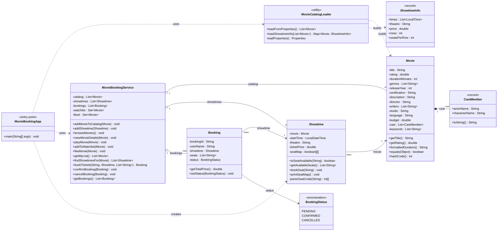

# Movie Booking App — Class Diagram

This diagram covers all classes in `com.modernjava.movieapp.moviebookingapp`
and how they relate, based on `MovieBookingApp.java` (entry point),
`MovieBookingService.java` (service/business logic), the domain models
(`Movie`, `Showtime`, `Booking`, `CastMember`, `ShowtimeInfo`), and the data
loader (`MovieCatalogLoader`).

## Notes on relationships

- **`MovieBookingApp`** is the console entry point; it depends on
  `MovieCatalogLoader` (to build the catalog + `ShowtimeInfo`) and
  `MovieBookingService` (to run the browse/detail/booking flow). It
  directly constructs `Showtime` objects from the loaded `ShowtimeInfo`.
- **`MovieCatalogLoader`** is a static utility that parses
  `movies.properties` into `Movie` objects and a
  `Map<Movie, ShowtimeInfo>`; it has no persistent state of its own.
- **`MovieBookingService`** is the aggregate root at runtime: it holds the
  full movie catalog, all registered showtimes, all bookings, and the
  watchlist/liked sets (aggregation — it does not own the lifecycle of
  `Movie`/`Showtime`, which can be reused across sessions).
- **`Movie`** composes a list of `CastMember` (composition — cast entries
  only exist as part of a movie) and is otherwise an immutable data model.
- **`Showtime`** references exactly one `Movie` and owns its own seat map
  (`boolean[][]`), independent of other showtimes for the same movie.
- **`Booking`** references exactly one `Showtime` and has a `BookingStatus`
  enum (`PENDING → CONFIRMED` or `PENDING → CANCELLED`).
- **`CastMember`** and **`ShowtimeInfo`** are Java `record`s — simple
  immutable value holders with no business logic.

## Use-case flow mapped to classes

1. `MovieBookingApp.main()` → `MovieCatalogLoader.loadFromProperties()` → `Movie` list
2. `MovieCatalogLoader.loadShowtimeInfo()` → `ShowtimeInfo` per `Movie`
3. `MovieBookingApp` builds `Showtime` objects → `MovieBookingService.addShowtime()`
4. `MovieBookingService.browseMovies()` / `viewMovieDetails()` → read `Movie`
5. `MovieBookingService.playMovie()` / `addToWatchlist()` / `likeMovie()` → mutate watchlist/liked sets
6. `MovieBookingService.bookTickets()` → validates + books seats on `Showtime`, creates `Booking` (`PENDING`)
7. `MovieBookingService.confirmBooking()` → `Booking.status = CONFIRMED`
8. `MovieBookingService.cancelBooking()` → `Booking.status = CANCELLED` (not yet wired into `MovieBookingApp`'s console flow)
