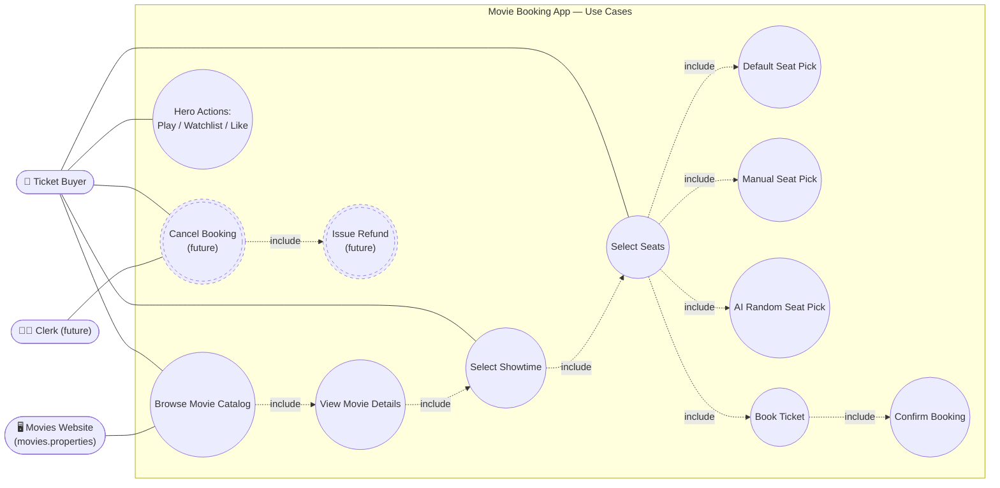

# Movie Booking App — Use Case Diagram
### (derived from `MovieBookingApp_Lo-Fi_Wireframe.md`)

The wireframe document walks through 7 screens driven by actors interacting
with the system. This diagram re-expresses that same flow as a **Use Case Diagram** (actors + use cases + `<<include>>` relationships), in the same
style as the original `Movie Ticket Reservation System.png` diagram.

## Use-case descriptions

| Use Case | Actor(s) | Maps to (from wireframe) |
|---|---|---|
| **Browse Movie Catalog** | Ticket Buyer, Movies Website | Screen 1 — `MovieBookingService.browseMovies()` |
| **View Movie Details** | Ticket Buyer | Screen 2 — `viewMovieDetails(Movie)` (Overview tab: description, production details, cast, keywords) |
| **Hero Actions** (Play / Watchlist / Like) | Ticket Buyer | Screen 3 — `playMovie()`, `addToWatchlist()`, `likeMovie()` |
| **Select Showtime** | Ticket Buyer | Screen 4 — picks from `ShowtimeInfo.times()` |
| **Select Seats** | Ticket Buyer | Screen 5 — presents the 3-option seat menu |
| ↳ Default Seat Pick | Ticket Buyer | Option 1: quick-pick seats `C1,C4,C3` |
| ↳ Manual Seat Pick | Ticket Buyer | Option 2: type comma-separated seat codes |
| ↳ AI Random Seat Pick | Ticket Buyer | Option 3: shuffle + pick N available seats |
| **Book Ticket** | Ticket Buyer | Screen 6 — `bookTickets()` creates a `Booking` (`PENDING`) |
| **Confirm Booking** | Ticket Buyer | Screen 6 — `confirmBooking()` sets status `CONFIRMED`, charges total |
| **Cancel Booking** *(future, dashed)* | Ticket Buyer, Clerk | Screen 7 — `cancelBookingWithRefund()`; not yet wired into console menu |
| **Issue Refund** *(future, dashed)* | — (system-triggered, included by Cancel Booking) | Screen 7 — `calculateRefundAmount()` applies the refund policy (100%/50%/0%) |

## Notes

- Solid ellipses = implemented and reachable from `MovieBookingApp.main()`.
- Dashed ellipses (**Cancel Booking**, **Issue Refund**) = implemented at the
  service layer (`MovieBookingService.cancelBookingWithRefund`,
  `calculateRefundAmount`, `Showtime.releaseSeat`) but **not yet exposed**
  via a console menu — matching the "future/stub" note in the wireframe.
- `<<include>>` arrows mirror the mandatory step-ordering shown in the
  wireframe's screen sequence and sequence diagram (e.g. you cannot reach
  **Book Ticket** without first completing **Select Seats**).
- **Clerk** is introduced here (as in the original
  `Movie Ticket Reservation System.png` diagram) as the actor who performs
  cancellations on a buyer's behalf once Epic 7 is implemented.
