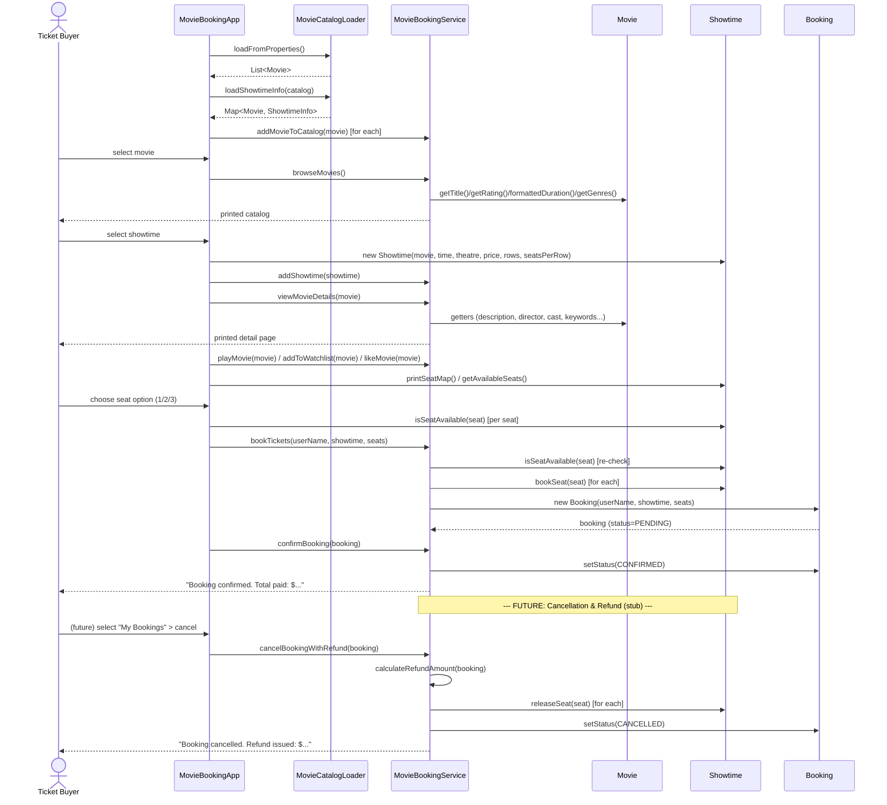

# Movie Booking App — Sequence Diagram

This sequence diagram was extracted from `MovieBookingApp_Lo-Fi_Wireframe.md`
(section 3). It shows the end-to-end object interaction flow per the class
diagram in `MovieBookingApp_ClassDiagram.md`, including the cancellation/refund stub.

## End-to-end sequence diagram (object interactions per the MovieBookingApp Class Diagram)

## Notes

- Screen/step order matches the 7 screens described in
  `MovieBookingApp_Lo-Fi_Wireframe.md`.
- The final block (cancellation/refund) is **future/stub-only**: the
  underlying methods (`Showtime.releaseSeat`,
  `MovieBookingService.calculateRefundAmount`,
  `MovieBookingService.cancelBookingWithRefund`) exist and compile, but
  `MovieBookingApp`'s `main` method does not yet call them.
- For the full refund policy (100%/50%/0% thresholds), see
  `MovieBookingApp_Wireframe.md` and `../../../requirementdocs/MovieBookingApp_PRD.md` (Epic 7).
